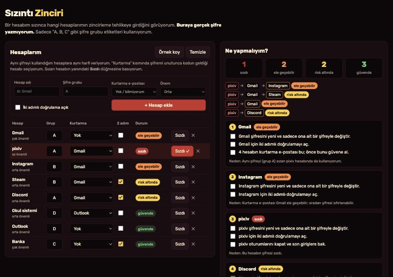
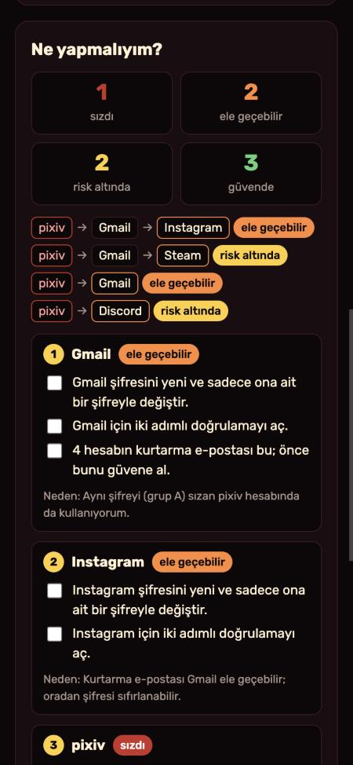

# Sızıntı Zinciri

Aklıma bu geldi: Bir sitede şifre sızıntısı olduğunu duyunca ben sadece o sitenin şifresini değiştiriyorum. Ama aynı şifreyi başka yerde de kullanmış olabilirim. O sitenin kurtarma e-postası da başka bir hesabıma bağlı olabilir. Böylece tehlike zincir gibi yayılıyor. Ben bu aracı bunun için yaptım. Hesaplarımı yazıyorum, sızanı işaretliyorum. Araç bana hangi hesaplarımın tehlikede olduğunu ve neyi hangi sırayla yapmam gerektiğini gösteriyor. Bu iki resim, benim çalıştırdığım uygulamanın gerçek ekranları.

**Ben buraya gerçek şifre yazmıyorum.** Aynı şifreyi kullandığım hesaplara aynı harfi veriyorum: A, B, C gibi.

## Ben nasıl kullanıyorum?

1. Ben bu klasörde `python3 -m http.server 8000` çalıştırıyorum. Sonra `http://localhost:8000` açıyorum.
2. Ben her hesabım için adını, şifre grubunu (harf), kurtarma e-postasını, önemini ve iki adımlı doğrulamanın açık olup olmadığını yazıp "+ Hesap ekle" diyorum.
3. Ben sızıntı haberini duyduğum hesabın yanındaki **Sızdı** düğmesine basıyorum.
4. Ben sağda dört sayıyı görüyorum: sızdı, ele geçebilir, risk altında, güvende. Altında `pixiv → Gmail → Instagram` gibi zincirler çıkıyor.
5. Ben "Ne yapmalıyım?" listesini sırayla yapıyorum. Yaptığım adımın kutusunu işaretliyorum. Her adımın altında nedenini okuyorum.
6. Ben "Yedeğimi indir" ile listemi JSON dosyasında saklıyorum. "Yedeğimi yükle" ile geri getiriyorum. Önce uygulama bana soruyor.

Ben "Örnek koy" ile hemen deneyebiliyorum. Örnekte **pixiv** sızıyor. pixiv ile aynı şifreyi kullanan **Gmail** ele geçebilir oluyor. Gmail 4 hesabımın kurtarma e-postası olduğu için listede **ilk sıraya** geçiyor.

## Ben içeride ne yaptım?

Ben her hesap için dört şeye baktım: şifre grubu, kurtarma e-postası, iki adımlı doğrulama ve önem. Kurallarım şunlar:

- Sızan hesabın şifre grubundaki başka bir hesapta iki adımlı doğrulama yoksa o hesap **ele geçebilir**. Varsa **risk altında**.
- Bir hesabın kurtarma e-postası ele geçebilirse, o hesabın şifresi de sıfırlanabilir. İki adımlı doğrulama yoksa o da **ele geçebilir** oluyor, varsa **risk altında**.
- Ben bu ikinci kuralı zincir bitene kadar tekrar ettim. Böylece `A → B → C → D` gibi uzun zincirler de bulunuyor. İki hesap birbirinin kurtarması olsa bile döngüye takılmıyor.

Sıralamada tehlikedeki hesaplara, önemli hesaplara ve başka hesapların kurtarma e-postası olan hesaplara daha çok puan verdim. Bu yüzden kurtarma e-postam en başa çıkıyor. Çünkü onu kapatmadan diğerlerini değiştirmek yetmiyor.

Ben `core.mjs` içinde bu hesapları, `app.mjs` içinde ekranı tuttum. Listem hiçbir sunucuya gitmiyor. Ben hesap ya da API anahtarı kullanmıyorum. Tarayıcı verilerini silersem listem gider. Bu yüzden yedek düğmelerini ekledim. Yedek dosyamda şifre yok ama hangi hesaplarımın aynı şifreyi paylaştığı var. Bu yüzden onu herkese açık yere koymam.

## Ben neyi sınadım?

Ben `node test.mjs` komutunu çalıştırdım. **31 kontrol** geçti. Örnekte pixiv sızınca sonuç **1 sızdı, 2 ele geçebilir, 2 risk altında, 3 güvende** çıktı. Sıralamada ilk hesap Gmail oldu. 4 basamaklı zincirin sonundaki hesap ele geçebilir çıktı. Zincirin ortasında iki adımlı doğrulama açınca sondaki hesap güvende kaldı. Birbirinin kurtarması olan iki hesapta döngüye girmedi. Bozuk satırlar temizlendi. Yedeği indirip yükleyince aynı sonuç çıktı. Yedekte şifre alanı olmadığını da kontrol ettim.

Ben uygulamayı tarayıcıda da açtım. Gmail'de iki adımlı doğrulamayı açınca Gmail **risk altında** oldu ve Instagram **güvende** oldu. Sonra Outlook'u sızdı yaptım. Outlook'u kurtarma e-postası olarak kullanan Okul sistemi ele geçebilir oldu. Yeni eklediğim **Epic Games** hesabını D grubuna koyunca o da ele geçebilir oldu. Telefon boyutunda kartlar alt alta dizildi, tablo kendi içinde kaydı.

Benim sınırlarım var. Bu araç gerçek sızıntı listelerine bakmıyor; sızıntıyı ben işaretliyorum. Şifrenin güçlü mü zayıf mı olduğunu bilmiyor. İki adımlı doğrulamanın SMS mi uygulama mı olduğunu ayırmıyor, ikisini aynı sayıyor. Sadece benim yazdığım bağlantıları biliyor; unuttuğum bir kurtarma e-postasını bulamaz. Bu bir güvenlik uzmanının yerine geçmez. İleride telefon numarası bağlantısını ve iki adımın türünü eklemek isterim.

## Ben bugünün kaynaklarına nasıl baktım?

Ben 21 Ekim 2026 saat 18.05 Türkiye vaktinde [GitHub Trending günlük listesine](https://github.com/trending?since=daily) baktım. Gördüğüm 13 repo arasında [MadsLorentzen/ai-job-search](https://github.com/MadsLorentzen/ai-job-search) için "bugün 3.131 yıldız" yazıyordu. İkinci sırada bir güvenlik denetimi aracı olan [cloudflare/security-audit-skill](https://github.com/cloudflare/security-audit-skill) vardı. Bu, bütün GitHub'ın kesin birincisi olduğu anlamına gelmez. Ben onların kodunu kopyalamadım.

Ben aynı anda [Trends24 dünya listesinde](https://trends24.in/) ilk sıralarda `緊急メンテ` (acil bakım), `pixiv` ve `パスワード` (şifre) sözcüklerini gördüm. Japonya'da pixiv ile ilgili bir şifre ve acil bakım konusu konuşuluyor gibiydi. Ben ne olduğunu kesin bilmiyorum ve bu yüzden bir sızıntı olduğunu iddia etmiyorum. Ama bu bana "bir sitede şifre sorunu olunca ben ne yapmalıyım?" sorusunu düşündürdü. Örneğimde pixiv'i bu yüzden kullandım; gerçek bir olayı anlatmıyor.

Ben [Reddit r/popular Top/Today listesinde](https://www.reddit.com/r/popular/top/?t=day) ilk görünen gönderinin r/Snorkblot'taki [“Well put.”](https://www.reddit.com/r/Snorkblot/comments/1xawoi2/well_put/) olduğunu gördüm. Bu tek görünüm, bütün Reddit'in en çok konuşulan konusunu kanıtlamaz. Ben bunu uygulamama zorla eklemedim.

Ben bu projeyi MIT lisansı ile paylaşıyorum.
